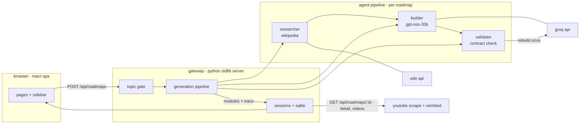

# FOKUS architecture

FOKUS generates eight-module learning roadmaps with live web research, real
YouTube results and course links. This document maps the system to the
engineering practices it demonstrates: agent orchestration, granular tracing,
LLM-native metrics, and accessibility.

## system map

## request lifecycle

1. **gate** — `topic_check()` scores keyboard-run patterns, repeats and entropy;
   scores of 2 are corroborated against wikipedia. `llm_topic_check()` asks the
   model whether the topic is learnable ("banana" is refused with suggestions).
   the judge fails open so outages never block real learners.
2. **researcher** — `wiki_research()` pulls grounding sources (no llm calls,
   timed as a tool stage in the trace).
3. **builder** — one groq call (gpt-oss-20b) writes the eight modules from the
   research pack. json is parsed defensively: reasoning models wrap output in
   prose, so we take the outermost braces.
4. **validator** — enforces the eight-module contract; if the model truncated,
   it appends a repair turn and regenerates once.
5. **persistence** — modules and the full trace land in sqlite; deep links and
   refreshes restore everything via `GET /api/roadmaps/:id`.

## tracing and llm-native metrics

every groq call records `prompt_tokens`, `completion_tokens`, wall-time ms and
tok/s (`completion_tokens / elapsed`). the orchestrator wraps each agent in a
stage boundary, so a roadmap's trace is a list of stages each owning its calls.
totals roll up to tokens, tok/s and an indicative cost-per-request
(`$0.05/$0.10 per million tokens`; the demo runs on groq's free tier).

- per roadmap: `GET /api/roadmaps/:id` returns `trace` + `traceTotals`
- account-wide: `GET /api/metrics` aggregates calls, tokens, tok/s, cost
- surfaced in the ui: the roadmap page "generation trace" panel and the
  settings "engine" card

## accessibility

- visible keyboard focus (`:focus-visible`) and `prefers-reduced-motion` support
- skip-to-content link; `main` landmark; `aria-current="page"` on nav
- live regions (`role="status"`) announce generation progress
- contrast-checked palette; icon-only controls carry aria-labels and titles

## data

sqlite (`fokus.db`): `users` (scrypt hashes), `sessions` (http-only cookies,
30 days), `roadmaps` (modules json, generation trace json, per-module `doneAt`
timestamps that feed the sidebar activity calendar).

## role-bullet mapping

| role bullet | where FOKUS shows it |
| --- | --- |
| accessible technologies | skip link, focus-visible, reduced motion, live regions, aria |
| backend + modern environments | python stdlib server, sqlite, scrypt auth, subpath spa hosting |
| multi-agent orchestration | researcher / builder / validator pipeline with repair turns |
| granular tracing + state management | per-stage, per-call traces persisted and rendered |
| llm-native metrics | tokens, tok/s, latency, cost-per-request in ui + api |
| technical communication | this document, DESIGN.md, PRODUCT.md |
