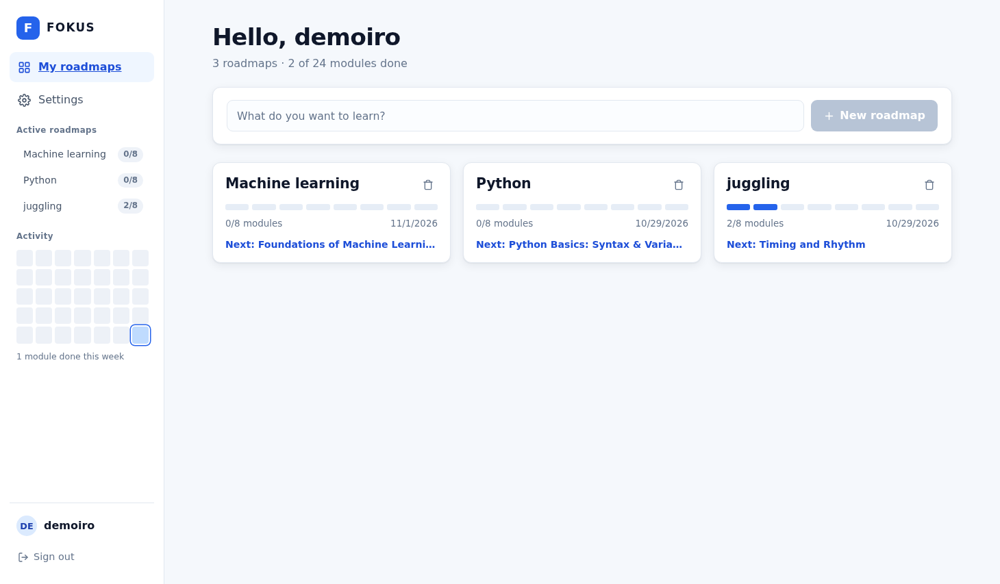
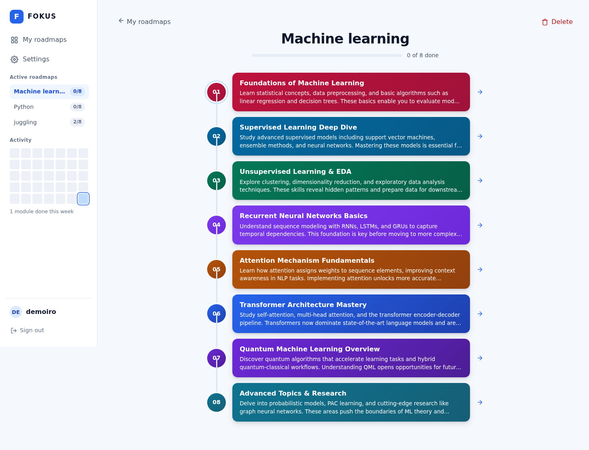
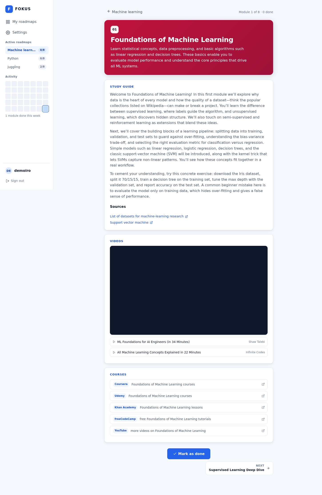

# FOKUS: AI learning roadmaps that hold you to the plan

FOKUS turns any topic into an 8-module learning roadmap in one click, then keeps you moving through it: tutor-style study guides, real videos and courses for every module, progress tracking, and an activity streak that shows how consistently you're learning.

## Start here

| | |
|---|---|
| **Live app** | [gateway-hermes.tail62f36e.ts.net/fokus](https://gateway-hermes.tail62f36e.ts.net/fokus) — demo account `demoiro` / `fokus123` (try "machine learning", "python", or anything you want to learn) |
| **One-line pitch** | type a topic → get a structured 8-module path with guides and vetted resources → tick modules off |
| **Original pitch deck** | [View on Canva](https://www.canva.com/design/DAGvq1zD1Iw/HU_JbNEXYYWzOLt2WvFHTg/edit?utm_content=DAGvq1zD1Iw&utm_campaign=designshare&utm_medium=link2&utm_source=sharebutton) — the pitching-competition concept this grew from |
| **Built with** | React + TypeScript (Vite), Python stdlib backend, SQLite, Groq + Wikipedia |

## What FOKUS does

1. **Generate.** Type any learnable topic; the engine (Groq + Wikipedia) plans an 8-module roadmap — ordered, described, and scoped from foundational to advanced.
2. **Gate nonsense.** A two-layer check rejects gibberish and non-subjects before any generation runs: an algorithmic nonsense scorer, then a tiny LLM judge that asks "is this actually a learnable skill, craft, or field?" — with did-you-mean suggestions when it says no.
3. **Guide.** Each module has a free-form, tutor-style study guide — flowing prose that weaves the concepts, a hands-on exercise, and one common mistake into the reading, with sources linked.
4. **Recommend for real.** Videos are scraped from live YouTube search and oEmbed-verified; course links are deterministic platform deep-links. Nothing is LLM-fabricated — if it's on the page, it exists.
5. **Track.** Mark modules done, watch the progress bar fill, and keep the activity streak alive. Roadmaps, guides, and resources are generated once and stored in SQLite, so nothing regenerates or drifts.

## The screens

| | |
|---|---|
|  **The roadmap.** Your 8 modules as a vertical timeline with a progress rail. Click any module card to open it — colors mark each stage of the path. |  **A module.** The study guide in tutor prose, its sources, real video picks you can play or open, and course links by platform. **✓ Mark as done** fills the progress bar; **NEXT** advances the timeline. |
|  **Home.** All your roadmaps with progress, due dates, and each one's next module — one click back into the flow. Type a topic in the box to spin up a new roadmap. | |

## How it works

`src/` is the React + TypeScript frontend (Vite). The backend is a dependency-free Python `server.py`: scrypt-hashed accounts with HttpOnly sessions, per-roadmap rows in SQLite (modules stored as JSON, generated once and served from the store), Groq + Wikipedia for generation, and tiered rate limits across AI and auth endpoints so the free-tier API keys stay safe. The topic gate closes the loop between "any topic you type" and "a roadmap worth following".

## Repository layout

- `src/` — React + TypeScript app (views, roadmap timeline, module pages)
- `server.py` — the backend (deployed instance alongside `fokus.db`)
- `docs/screenshots/` — the images on this page

## Status and honest limits

A working, deployed app in active personal use. Generated content quality depends on Groq's model; the resource picker only surfaces what YouTube search and the major course platforms expose. This project is part of my ongoing learning in TypeScript and full-stack development — some starter scaffolding was AI-assisted, but the design, feature decisions, and implementations are my own.

## Contact

📧 sherianne.sactt@gmail.com
